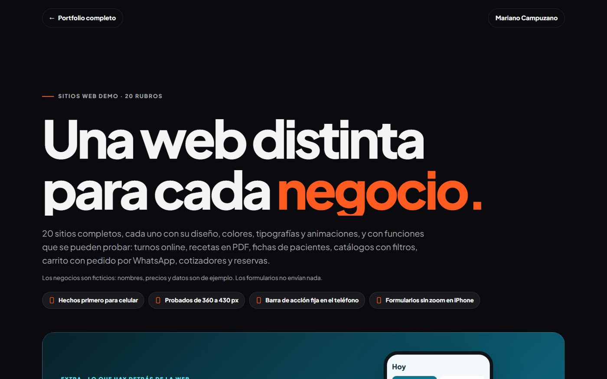
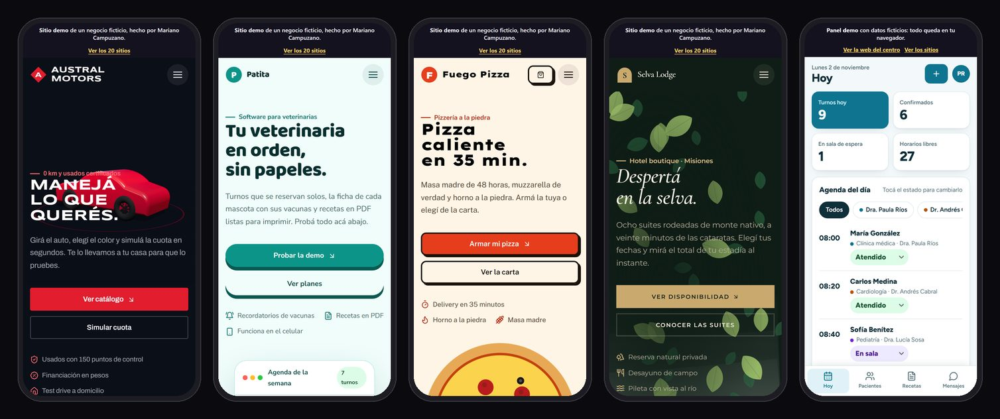
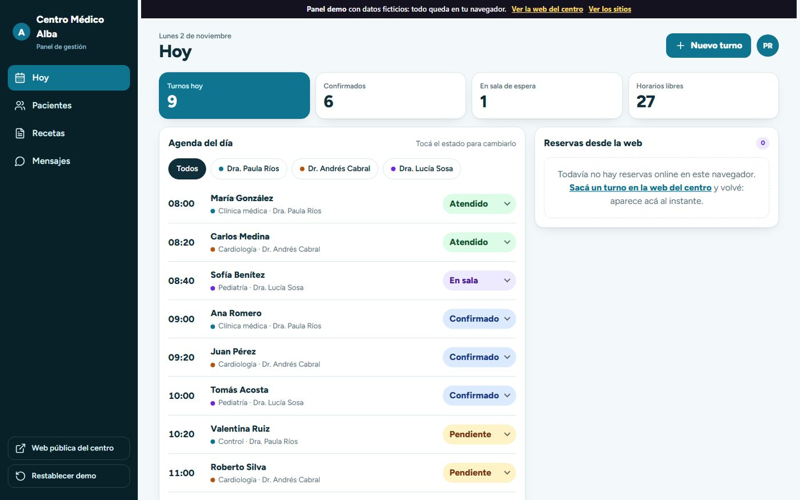

<div align="center">

# Julio Mariano Campuzano · Web, automatización e IA

**Sitios web para negocios, paneles de gestión y automatizaciones con datos.**
Todo lo que está en este repo se ve y se usa bien en el celular.

[](https://juliomarianocampuzano-git.github.io/Portfolio-Julio-Mariano-Campuzano/)
[](https://juliomarianocampuzano-git.github.io/Portfolio-Julio-Mariano-Campuzano/portfolio/sitios/)
[](#-hecho-para-celulares)
[](https://wa.me/5493764148342)

</div>



## Qué vas a encontrar

| | Link | Qué es |
| --- | --- | --- |
| 🏠 | [Web principal](https://juliomarianocampuzano-git.github.io/Portfolio-Julio-Mariano-Campuzano/) | Servicios, diagnóstico, trabajos y contacto. |
| 🌐 | [20 sitios web por rubro](https://juliomarianocampuzano-git.github.io/Portfolio-Julio-Mariano-Campuzano/portfolio/sitios/) | Una web completa por tipo de negocio, cada una con su diseño y funciones que se pueden probar. |
| 🩺 | [Panel de gestión](https://juliomarianocampuzano-git.github.io/Portfolio-Julio-Mariano-Campuzano/portfolio/sitios/panel-alba/) | Lo que usa el consultorio detrás de la web: agenda, pacientes, recetas en PDF y recordatorios. |
| 🗂️ | [Portfolio de proyectos](https://juliomarianocampuzano-git.github.io/Portfolio-Julio-Mariano-Campuzano/portfolio/) | 61 proyectos de automatización, datos e IA con ficha y demo (ES / [EN](https://juliomarianocampuzano-git.github.io/Portfolio-Julio-Mariano-Campuzano/portfolio/en/)). |

## 📱 Hecho para celulares

La mayoría de los clientes de un negocio llega desde el teléfono (Instagram, Google Maps, WhatsApp). Por eso cada página se diseñó **primero para celular** y después se amplió a la compu.



- **Barra de acción fija abajo** en el teléfono, con la acción principal del negocio: *Sacar turno*, *Armar mi pizza*, *Simular cuota*…
- **Botones grandes** (44 px o más en las acciones principales) y menú a pantalla completa.
- **Formularios que no hacen zoom** en iPhone (textos de 16 px) y teclados correctos para teléfono y números.
- **Respeta el notch** y la barra de inicio del iPhone (zonas seguras).
- El panel de gestión cambia de **barra lateral (compu) a pestañas abajo (celular)**, como una app.
- En la galería, cada sitio tiene un botón **“Ver en celular”** que lo abre dentro de un teléfono, para verlo así desde la compu.

**Cómo lo controlé:** con un script de Playwright que abre las 22 páginas en 360 px y 390 px de ancho y revisa que no haya scroll de costado, texto cortado, errores de consola, botones chicos ni campos que hagan zoom. Última pasada: **0 problemas en 44 pruebas**.


## 🌐 Los 20 sitios

Cada uno tiene paleta, tipografías, estilo visual y animaciones propias, y al menos una función real para probar.

| # | Sitio | Rubro | Estilo | Para probar |
| --- | --- | --- | --- | --- |
| 01 | [Austral Motors](https://juliomarianocampuzano-git.github.io/Portfolio-Julio-Mariano-Campuzano/portfolio/sitios/austral-motors/) | Concesionaria de autos | Oscuro + auto 3D | Catálogo con filtros, simulador de cuotas, turnos para test drive |
| 02 | [Patita](https://juliomarianocampuzano-git.github.io/Portfolio-Julio-Mariano-Campuzano/portfolio/sitios/patita-vet/) | Software para veterinarias | Claymorphism | Turnos online, fichas clínicas, recetas en PDF |
| 03 | [Centro Médico Alba](https://juliomarianocampuzano-git.github.io/Portfolio-Julio-Mariano-Campuzano/portfolio/sitios/centro-medico-alba/) | Consultorio médico | Soft UI | Turnos online, recetas en PDF, fichas clínicas |
| 04 | [Sonríe](https://juliomarianocampuzano-git.github.io/Portfolio-Julio-Mariano-Campuzano/portfolio/sitios/sonrie-dental/) | Odontología | Soft UI | Cotizador de tratamientos, turnos online |
| 05 | [Pulso](https://juliomarianocampuzano-git.github.io/Portfolio-Julio-Mariano-Campuzano/portfolio/sitios/pulso-training/) | Gimnasio | Oscuro | Grilla de clases |
| 06 | [Brasa](https://juliomarianocampuzano-git.github.io/Portfolio-Julio-Mariano-Campuzano/portfolio/sitios/brasa-parrilla/) | Parrilla y restaurante | Oscuro | Carta con pedido, reserva de mesa |
| 07 | [Grano](https://juliomarianocampuzano-git.github.io/Portfolio-Julio-Mariano-Campuzano/portfolio/sitios/grano-cafe/) | Cafetería de especialidad | Neubrutalismo | Carta con pedido, tarjeta de sellos |
| 08 | [Monolito](https://juliomarianocampuzano-git.github.io/Portfolio-Julio-Mariano-Campuzano/portfolio/sitios/monolito-arquitectura/) | Estudio de arquitectura | Suizo + bloques 3D | Cotizador por m² |
| 09 | [Habitar](https://juliomarianocampuzano-git.github.io/Portfolio-Julio-Mariano-Campuzano/portfolio/sitios/habitar-propiedades/) | Inmobiliaria | Glassmorphism | Catálogo con filtros, simulador de cuotas |
| 10 | [Lex Norte](https://juliomarianocampuzano-git.github.io/Portfolio-Julio-Mariano-Campuzano/portfolio/sitios/lex-norte-abogados/) | Estudio jurídico | Editorial de lujo | Test para orientar la consulta, turnos online |
| 11 | [Balance](https://juliomarianocampuzano-git.github.io/Portfolio-Julio-Mariano-Campuzano/portfolio/sitios/balance-contable/) | Estudio contable | Suizo | Vencimientos por CUIT |
| 12 | [Navaja](https://juliomarianocampuzano-git.github.io/Portfolio-Julio-Mariano-Campuzano/portfolio/sitios/navaja-barber-club/) | Barbería | Neubrutalismo | Turnos online |
| 13 | [Selva Lodge](https://juliomarianocampuzano-git.github.io/Portfolio-Julio-Mariano-Campuzano/portfolio/sitios/selva-lodge/) | Hotel boutique | Editorial de lujo | Reservas por calendario con total |
| 14 | [Ruta Norte](https://juliomarianocampuzano-git.github.io/Portfolio-Julio-Mariano-Campuzano/portfolio/sitios/ruta-norte-viajes/) | Agencia de viajes | Glassmorphism | Catálogo de viajes, cotizador por pasos |
| 15 | [Telar](https://juliomarianocampuzano-git.github.io/Portfolio-Julio-Mariano-Campuzano/portfolio/sitios/telar-moda/) | Tienda de ropa | Editorial de lujo | Catálogo con carrito |
| 16 | [Kairos](https://juliomarianocampuzano-git.github.io/Portfolio-Julio-Mariano-Campuzano/portfolio/sitios/kairos-idiomas/) | Instituto de idiomas | Claymorphism | Test de nivel |
| 17 | [Escudo](https://juliomarianocampuzano-git.github.io/Portfolio-Julio-Mariano-Campuzano/portfolio/sitios/escudo-seguros/) | Productor de seguros | Soft UI | Cotizador de seguro del auto |
| 18 | [Solaria](https://juliomarianocampuzano-git.github.io/Portfolio-Julio-Mariano-Campuzano/portfolio/sitios/solaria-energia/) | Energía solar | Soft UI | Calculadora de ahorro |
| 19 | [Espacio Calma](https://juliomarianocampuzano-git.github.io/Portfolio-Julio-Mariano-Campuzano/portfolio/sitios/espacio-calma/) | Consultorio de psicología | Soft UI | Respiración guiada, turnos online |
| 20 | [Fuego Pizza](https://juliomarianocampuzano-git.github.io/Portfolio-Julio-Mariano-Campuzano/portfolio/sitios/fuego-pizza/) | Pizzería y delivery | Neubrutalismo | Armador de pizza, carrito, seguimiento del pedido |

## 🩺 Panel de gestión: lo que hay detrás de la web

Una web bonita trae clientes; el sistema detrás le ahorra horas al negocio. El [panel de Centro Médico Alba](https://juliomarianocampuzano-git.github.io/Portfolio-Julio-Mariano-Campuzano/portfolio/sitios/panel-alba/) muestra esa otra parte:

- **Agenda del día** con estados (pendiente, confirmado, en sala, atendido, ausente) y filtro por profesional.
- **Reservas desde la web:** sacá un turno en la [web del centro](https://juliomarianocampuzano-git.github.io/Portfolio-Julio-Mariano-Campuzano/portfolio/sitios/centro-medico-alba/#turnos) y aparece en el panel al instante.
- **Pacientes** con buscador, alergias destacadas e historia clínica.
- **Recetas en PDF** generadas en el navegador (con marca “DEMO, sin validez”).
- **Recordatorios por WhatsApp** 24 h antes, con vista previa del mensaje.



## 🛠️ Con qué está hecho

Sin frameworks pesados: HTML, CSS y JavaScript, generados con Python a partir de los datos de cada sitio.

| Librería (GitHub) | Para qué |
| --- | --- |
| [GSAP](https://github.com/greensock/GSAP) + ScrollTrigger, SplitText, Flip | Textos que se arman letra por letra, secciones fijadas, contadores |
| [Lenis](https://github.com/darkroomengineering/lenis) | Scroll suave |
| [three.js](https://github.com/mrdoob/three.js) | Auto 3D que cambia de color, bloques de arquitectura |
| [vanilla-tilt.js](https://github.com/micku7zu/vanilla-tilt.js) | Tarjetas que se inclinan con el mouse |
| [jsPDF](https://github.com/parallax/jsPDF) | Recetas en PDF |
| [canvas-confetti](https://github.com/catdad/canvas-confetti) | Celebración al confirmar un turno o pedido |
| [Lucide](https://github.com/lucide-icons/lucide) · [Fontsource](https://github.com/fontsource/fontsource) | Íconos y 32 tipografías libres |
| [ui-ux-pro-max-skill](https://github.com/nextlevelbuilder/ui-ux-pro-max-skill) | Paletas, tipografías y estilos según el rubro |

También: respetan **“reducir movimiento”** del sistema, se usan con **teclado** y las librerías están copiadas en el repo (no dependen de servicios externos). Licencias en [CREDITOS.txt](portfolio/sitios/CREDITOS.txt).

## Estructura

```
index.html                  web principal
portfolio/                  portfolio de proyectos (ES y en/)
portfolio/sitios/           los 20 sitios, la galería y el panel
  build-sitios.py           genera todo a partir de sitios_a/b/c.py
  kit/                      estilos, animaciones y módulos compartidos
  panel-alba/               panel de gestión (app para celular y compu)
assets/libs/                GSAP, Lenis, three.js, jsPDF… (copias locales)
docs/                       capturas y notas de mantenimiento
```

Para regenerar los sitios: `python portfolio/sitios/build-sitios.py`. Cada push a `main` se publica solo en GitHub Pages.

## Honestidad

Los 20 negocios y el consultorio del panel son **ficticios**: nombres, precios, teléfonos y pacientes son de ejemplo, y cada página lo dice arriba. Los formularios no envían datos, las calculadoras son orientativas y no hay testimonios ni cifras inventadas. Los trabajos para clientes reales están marcados como tales en el [portfolio](https://juliomarianocampuzano-git.github.io/Portfolio-Julio-Mariano-Campuzano/portfolio/).

## Contacto

¿Querés una web así para tu negocio? Escribime por [WhatsApp](https://wa.me/5493764148342) o por [LinkedIn](https://www.linkedin.com/in/juliomcampuzano).

---

**English summary.** Portfolio of Julio Mariano Campuzano: 20 complete demo websites for different industries (car dealership, vet software, medical clinic, restaurant, real estate and more), each with its own design and working features (bookings, PDF prescriptions, catalogs, carts, quote builders), plus a management dashboard that receives the bookings made on the public site. **Everything is built mobile-first** and was checked automatically at 360 and 390 px. [Open the gallery](https://juliomarianocampuzano-git.github.io/Portfolio-Julio-Mariano-Campuzano/portfolio/sitios/) · [English portfolio](https://juliomarianocampuzano-git.github.io/Portfolio-Julio-Mariano-Campuzano/portfolio/en/).
